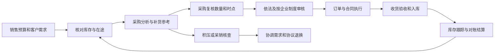

# 岗位需求与业务流程

需求依据为广州医药采购业务岗职位描述（项目输入材料），重点对应采购时点与批量调整、库存结构优化、呆销核查和数据汇总统计。以下为分析项目的流程设计，不代表该企业内部操作规程。

| 岗位职责 | 项目分析功能 | 实际应用所需补充信息 |
| --- | --- | --- |
| 按需进货、保障货源 | 预测、补货参考、安全库存和满足率 | 销售预算、订单、关键品种要求、可用库存与在途 |
| 调整时点和批量 | 月度固定覆盖与动态补货比较 | 真实交期、包装倍数、限额、采购资金与供应约束 |
| 在库协调、清理呆销 | ABC、覆盖量、呆销规则、人工核查清单 | 批号效期、仓储状态、需求变化及退换协议 |
| 供应商协作 | 交期变化场景，说明交期影响 | 供应商逐单承诺与实际到货；本版不编造评分 |
| 发票录入、结算 | 理解订单、到货与付款的区别 | 没有真实发票和账期，范围内不做结算功能 |
| 资质和质量协作 | 数量分析与法定质量审核分开 | 不因模型显示“正常”就认为资质或药品合格 |

## 实际业务中的位置

本项目主要覆盖采购分析、补货参考及积压或呆销核查。模拟流水用于验证补货逻辑，不执行实际下单、发票核销或库存变更。

## 分析执行顺序

1. 下载并校验公开包，提取白名单数据，保留原件。
2. 统一编码与数字格式，检查一品种一月份主键及完整日历；冲突停算。
3. 用验证期为各品种选择预测方法，测试期逐月滚动预测。
4. 用同一期初库存与需求，模拟到货、下单、履约、缺口和结存。
5. 同时评估库存、成本和供应保障，再看交期变化。
6. 独立使用末期前库存快照形成 ABC 和风险清单。高积压时不直接输出可执行采购数量；冲突信号转人工核查。
7. 从同一个计算结果生成网页、Excel 和报告。

## 不越过的业务边界

《药品经营质量管理规范》第 17、61、72、81、85、87 条涉及质量职责、采购合法性、收货验收、效期控制及不合格品处置。项目只形成数量与资金预警，不能完成上述审核。法规出处：[市场监管总局公开文本](https://www.samr.gov.cn/zw/zfxxgk/fdzdgknr/bgt/art/2023/art_bc07ffdb7a1c4e46be371ac5a4a65f9c.html)，检索日期 2026-11-02。

没有效期数据就不出近效期结论；没有质量状态就不称可售库存；没有供应商记录就不编造合作和议价收益。退换、调剂和报废仅为经核实后可讨论的路径，不能自动执行。ABC 衡量资金分布，不能替代临床重要性评价。
