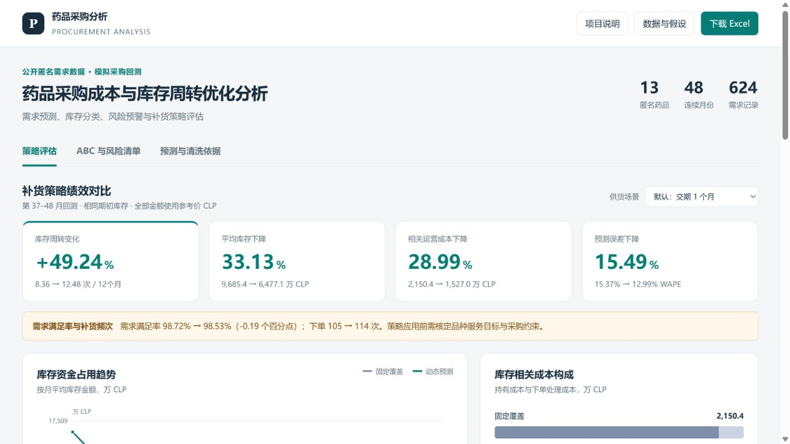

# 药品采购成本与库存周转优化分析

基于公开匿名药品需求数据的采购分析与策略回测项目。围绕需求预测、库存资金占用、供应保障和风险核查，使用 **Python、Pandas、Excel 与交互式网页**构建可复现的分析流程。开发过程采用 AI 辅助编程，计算依据、参数及验证记录随项目提供。

## 项目展示

<!-- LIVE_DEMO_START -->
在线访问地址将在 GitHub Pages 部署验证后提供。本地可双击 `打开看板.cmd` 或打开 `outputs/demo/index.html`，无需安装分析环境。
<!-- LIVE_DEMO_END -->

看板包含策略评估、ABC 与风险清单、预测与清洗依据三个视图，另附可直接浏览的项目说明和分析报告。



- [采购分析报告](outputs/demo/ANALYSIS_REPORT.md)：评价口径、回测结果、风险案例与建议。
- [业务流程说明](BUSINESS_FLOW.md)：岗位职责对应关系和业务审核边界。
- [数据字典](DATA_DICTIONARY.md)：原始字段、派生指标、单位和计算规则。

## 数据来源与模拟范围

需求和参考输入来自 Fernando Rojas 发布的[公开匿名医院药房数据](https://zenodo.org/records/22286723)，DOI `10.5281/zenodo.22286723`，CC BY 4.0。共有 13 个药品、48 个连续月序号、624 条请求需求。下载包的 MD5 已与发布页核对。

它不是广州医药或中国医药商业公司的内部数据。医院记录的真实性来自作者说明，本项目没有审计医院原始系统。保留 M01–M13，不给匿名药品编造名称。数量单位沿用原数据；单价使用名义 2023 年智利比索 CLP，不标成人民币。

本项目新增了简单补货规则、库存回测、风险判定和清洗压力测试。采购交期、起始库存政策、持有成本率等是明确设置的模拟假设；实际采购合同、供货商、发票、批次效期没有补造。**所有“改善百分比”是本项目运行结果，不是企业经营成果，也没有套用原作者论文中的数字。**

## 业务问题与分析框架

核心问题是比较固定覆盖与动态补货策略在库存资金占用、相关运营成本和供应保障方面的表现。

1. 核查原始数据，保留可追溯来源。
2. 按历史误差选择容易解释的预测方法，留出最后 12 个月测试。
3. 在相同条件下比较固定覆盖和动态补货，同时报告缺货、订单及期末库存。
4. 用 ABC 和库存覆盖识别需要核实的品种；信号冲突时暂停直接采纳模型建议。

实测结果与完整口径见 `outputs/demo/ANALYSIS_REPORT.md`。典型案例 M13 的 170 单位库存按近期月均需求 15 单位估算可覆盖 11.33 个月，但未触发连续 3 月无需求的呆销规则。历史波动缓冲又产生补货信号，因此暂缓直接采纳模型建议并转人工复核。

## 通用运行与静态发布

Python 3.12+ 环境可执行：

```bash
pip install -r requirements.txt
python run_project.py
python -m unittest discover -s tests -v
```

原始公开数据包随项目保留，分析运行时不访问网络。生成网页、报告、CSV 和结果 JSON 后，可执行 `python tools/prepare_publication.py` 准备 GitHub 仓库内容与 `docs/` 静态页面。该命令只生成本地文件，不创建 Git 提交或上传远端。

仅调整页面和报告措辞时，可执行 `python run_project.py --presentation-only`。程序校验核心计算代码、参数及结果哈希后复用原有数值，不重新测量处理耗时。Excel 的重建依赖和本机运行方式见下文及 [本机运行说明](LOCAL_RUN.md)。

## 在本机重新运行

在项目目录打开 PowerShell：

```powershell
powershell -NoProfile -ExecutionPolicy Bypass -File .\重新生成.ps1
```

脚本使用已安装的 Codex 捆绑 Python、Pandas 与报表库，不下载数据或安装重复依赖。执行策略参数只对这一次进程生效，不更改系统设置。会更新 `outputs/demo/` 中的生成文件，原始数据保留。

如只重建分析、网页和 CSV：

```powershell
$env:PYTHONUTF8 = '1'
$env:PYTHONDONTWRITEBYTECODE = '1'
& "$env:USERPROFILE\.cache\codex-runtimes\codex-primary-runtime\dependencies\python\python.exe" run_project.py
```

仅运行核心测试：

```powershell
& "$env:USERPROFILE\.cache\codex-runtimes\codex-primary-runtime\dependencies\python\python.exe" -m unittest discover -s tests -v
```

没有 Codex 捆绑运行库的电脑，可以在自己的 Python 3.12+ 环境安装 `requirements.txt` 后执行 `python run_project.py`。分析与网页不依赖专用服务。Excel 的重建需要 `@oai/artifact-tool`；缺少此库时仍可查看已生成的 Excel 和重新生成的 CSV，但应重新导出 Excel 后再作同批结果展示，不能把旧工作簿当成新结果。

## 方法与重要假设

| 内容 | 本版设定 |
| --- | --- |
| 历史 / 验证 / 测试 | 第 1–24 / 25–36 / 37–48 月；无真实公历日期 |
| 对照政策 | 近 12 月平均需求 × 固定 3 月覆盖；是模拟对照 |
| 动态政策 | 预测需求 ×（交期 + 复核期）+ 历史保护期误差第 95 百分位缓冲 |
| 下单时点 | 月初到货后决策，再发生本月需求；扣除现有库存和在途 |
| 交期 / 复核 | 默认 1 月 / 1 月；额外展示交期 2 月敏感性分析 |
| 初始库存 | 第 25–36 月平均需求 × 3，向上取整；两策略相同 |
| 未满足需求 | 当期记缺口，后续不补单；不允许跨药品替代 |
| 库存成本 | 固定参考单价；持有率年化 20%；下单费使用作者参考字段 `o` |
| 平均库存 | 每月（到货后期初 + 期末）÷2，12 期取均值；不是日均实测库存 |
| 周转 | 实际满足需求的参考成本 ÷ 平均库存金额 |
| ABC | 第 36–47 月需求成本；按加入该品种前的累计占比划 A/B/C，80%/95% 阈值 |
| 快照风险 | 只使用第 1–47 月需求和第 48 月前库存，与回测流水分开 |
| 清理规则 | 连续 3 月无需求且有库存为呆销待核实；近6月均需求覆盖超过6月为积压 |
| 安全库存 | 预测误差缓冲；不是临床安全承诺、质量判定或服务达标保证 |
| 处理计时 | 合成约10万行脏数据；同规则 Python 逐行 vs Pandas，5轮中位耗时 |

不计算采购议价降价、真实现金节约、退货回款或效期损耗。医院需求迁移到批发采购仅用于方法演示。业务使用需要真实在途、交期波动、包装倍数、购进限额、关键品种要求和质量审核。

## 文件位置

| 文件/目录 | 用途 |
| --- | --- |
| `DESIGN.md` | 开发前的数据与范围设计 |
| `BUSINESS_FLOW.md` | JD 对应关系、业务流程与审核边界 |
| `DATA_DICTIONARY.md` | 原始与派生字段、公式、单位 |
| `BEGINNER_GUIDE.md` | 从 M13 案例开始的简短入门说明 |
| `analysis/` | 清洗、预测、库存和报告代码 |
| `tests/test_analysis.py` | 核心业务计算与边界测试 |
| `config.json` | 模拟参数；变更须重新运行并披露 |
| `data/source/` | 原始 CSV、作者说明、校验清单 |
| `research/` | 原始公开数据包、许可元数据快照 |
| `web/dashboard.html` | 网页模板，数据由 Python 嵌入 |
| `outputs/demo/` | 可用网页、Excel、报告、CSV、结果与运行记录 |
| `tools/export_workbook.mjs` | 从同一结果生成 Excel 并校验 |

## 复现与验证

一键脚本先运行核心测试，失败会停止生成。测试包含可手算案例、库存与在途守恒、未来信息隔离、预测方法冻结、异常冲突、零需求、呆销和风险冲突。网页切换展示预先计算的情景，分析参数与评价口径保持固定。

`run_manifest.json` 保存代码、配置、输入与生成结果的校验值。相同版本的库存回测数字应一致；生成时间与计时会随运行变化。Excel 使用数字单元格和少量校核公式，导出后做公式读回与四张工作表渲染检查。浏览器通过 localhost 检查交互；不同电脑对直接打开本地 HTML 的限制可能不同，可用 `python -m http.server 8766 --bind 127.0.0.1 --directory outputs/demo` 后访问本地地址。

## 来源与再使用

原始下载：`https://zenodo.org/records/22286723/files/healthcare-4503243_ZENODO_AUDITED_UPDATE.zip?download=1`。
MD5：`ef1ee4be3a21a07a4df37694690b12cc`。重新下载时先核对版本和校验值，不自动接受来源变化。

引用：Fernando Rojas, *Dataset and Code: A Data-Driven Decision Support Framework for Hospital Pharmacy Medication Supply under Demand Uncertainty*, v2, Zenodo, DOI 10.5281/zenodo.22286723。许可：[CC BY 4.0](https://creativecommons.org/licenses/by/4.0/)。本项目为新增分析，不表示原作者认可本项目的政策建议。

业务边界参考市场监管总局公开的[《药品经营质量管理规范》](https://www.samr.gov.cn/zw/zfxxgk/fdzdgknr/bgt/art/2023/art_bc07ffdb7a1c4e46be371ac5a4a65f9c.html)。不把旧版条文中的具体证照清单直接当作当前办理清单；实际适用要求需按现行制度核对。
